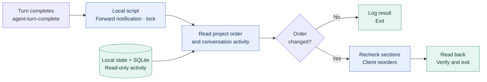

# Codex Pulse

**English** · [简体中文](README.md)

**Keep recently active Codex projects within reach.**

Codex Pulse is a small local utility for the Codex desktop app. After a conversation turn finishes, it checks your project order and moves recently active local projects up when needed.

The sorting script does not ask an AI model what to do. It compares timestamps, applies a fixed rule, and exits.

- Runs after a conversation finishes; no polling or persistent watcher.
- Makes no additional model calls for sorting.
- Updates the sidebar only when the calculated order differs.
- Preserves pinned projects, custom sections, and your existing notification handler.

## A quick example

Starting with **A → B → C**, assuming no other project becomes active:

| What you do | Resulting order | Sidebar updates |
| --- | --- | --- |
| Continue chatting in A | A → B → C | 0 |
| Finish a conversation turn in B | B → A → C | 1 |
| Continue chatting in B | B → A → C | 0 |

An unchanged result still involves starting the script, reading data, and recording a short log. **Zero sidebar updates does not mean zero local work.**

## What runs, and when?

1. You send a message, and Codex answers it normally.
2. When that turn finishes, the Codex software launches the local script.
3. The script reads project membership, recent conversation activity, and the current sidebar order.
4. It calculates the desired order. If the order already matches, it exits without updating the sidebar.
5. If the order differs, it asks the client to reorder projects, reads the result back, verifies it, and exits.

The event is named `agent-turn-complete`: it simply means **“the assistant has finished this turn.”** Codex provides it through the user-level `notify` setting. See the [official notification documentation](https://learn.chatgpt.com/docs/config-file/config-advanced#notifications).

| Component | Its job |
| --- | --- |
| AI model | Answers your normal conversation messages. |
| Codex software | Starts the callback after a turn and applies the requested sidebar order. |
| Codex Pulse script | Compares timestamps and decides whether the order needs to change. |

Your normal conversations still use your normal Codex allowance. **The sorting operation does not issue an additional model request.** It uses a small amount of local CPU and disk activity.

The script does not stay open waiting for messages. Codex launches it again after the next completed turn. Updates happen after a turn finishes, rather than while a response is still being generated.

## Architecture

<!-- architecture:start -->


[SVG](docs/diagrams/architecture.en.svg) · [PNG](docs/diagrams/architecture.en.png) · [Mermaid source](docs/diagrams/architecture.en.mmd)
<!-- architecture:end -->

Before the sorting check, the callback forwards the original notification and acquires a process lock. That lock serializes overlapping callbacks from multiple conversations.

| Module | Responsibility |
| --- | --- |
| [`bin/codex-pulse.mjs`](bin/codex-pulse.mjs) | Callback entry point, runtime configuration, and quiet error handling. |
| [`src/events.mjs`](src/events.mjs) | Recognize completion events and forward the original notification unchanged. |
| [`src/activity.mjs`](src/activity.mjs) | Read local activity from SQLite using a read-only connection. |
| [`src/planner.mjs`](src/planner.mjs) | Resolve project membership and calculate a stable order. |
| [`src/app-client.mjs`](src/app-client.mjs) | Call three allowed App Tools over the local pipe: list projects, list the sidebar, and reorder projects. |
| [`src/runner.mjs`](src/runner.mjs) | Coordinate locking, pre-write checks, updates, verification, and bounded logs. |
| [`scripts/configure.py`](scripts/configure.py) | Install or remove the callback through the Codex configuration API. |

## Why it is designed this way

### Run when there is something to check

A completed turn is a useful point to reconsider which project was recently active. Using that event avoids periodic checks while you are away and does not require a separate background service.

### Use a rule a small program can execute

For each project, take the latest eligible conversation activity time, then sort projects from newest to oldest. Prefer conversation recency fields over general metadata update times. Archived conversations, projectless conversations, and subagent activity are excluded. Ties retain the existing order; projects without activity follow projects with activity.

This rule handles multiple conversations inside one project consistently. It does not need a prompt, model inference, or an API key for sorting.

### Compare before changing anything

The planner calculates a target order before requesting an update. Running it repeatedly with the same effective activity and order produces no further sidebar changes. This property is called **idempotence**; here it simply means “running the same check again does not keep rearranging things.”

### Let the application update its own sidebar

Codex Pulse reads local state and SQLite data. It does not patch the Codex installation or overwrite the running client's global state file. Sidebar changes go through the client's existing App Tools transport, so the client handles the update.

### Check around a write

The script serializes its own concurrent runs, rechecks project sections before writing, and reads the order back afterward. If the layout changes during the check, it recalculates with a bounded retry. The transport has no atomic compare-and-swap operation, so these checks reduce the race window rather than provide a transaction across all clients.

### Make installation reversible

Installation saves the original notification command and a local configuration backup. The original notification is forwarded before the sorting check. Reinstalling does not add another wrapper. Uninstalling restores the previous command and refuses to overwrite a notification setting that someone subsequently changed.

## Get started

### Requirements

- Codex desktop with its local App Tools pipe available. The current implementation has been verified on **Windows**.
- **Node.js 24 or later** for the runtime and built-in SQLite support.
- **Python 3.11 or later** for the installer, which uses `tomllib` from the standard library.
- Git to clone the repository.

There are no npm or pip dependencies to install. The installer can use the runtimes supplied by Codex.

### Install

Clone the repository, then open the checkout as a project in Codex desktop:

```powershell
git clone https://github.com/flyl1u/fly-CodexPulse.git
cd fly-CodexPulse
```

Run the following from the project root through a Codex-provided shell that inherits the desktop app's environment:

```powershell
python scripts/configure.py install
python scripts/configure.py status
```

The installer finds executables through `CODEX_CLI_PATH`, `CODEX_MCP_NODE_PATH`, or PATH. You can also pass `--codex` and `--node` explicitly. Executable paths alone do not create the desktop pipe or the conversation context required by the runtime.

Installation changes the user-level `notify` setting through Codex's configuration API and checks that unrelated configuration values remain unchanged. The callback runs once Codex loads the updated configuration.

**Keep the checkout at its installed location.** The callback references it by absolute path; uninstall before moving or deleting it.

### Confirm it has run

Finish a normal conversation turn, then inspect `runtime/events.jsonl`. A record with `trigger: "notify"` comes from the completion callback; `check` and `apply` identify manual runs.

Relevant fields look like this:

```jsonl
{"trigger":"notify","status":"sorted","count":3,"writes":1}
{"trigger":"notify","status":"unchanged","count":3,"writes":0}
```

`writes` counts sidebar reorder requests. The log and lock file are separate local writes. `status` from the installer confirms the configuration; an event record confirms that the callback actually ran.

### Inspect or apply an order manually

These commands require the desktop-provided `CODEX_APP_TOOLS_PIPE_PATH` and the current conversation identity:

```powershell
& $env:CODEX_MCP_NODE_PATH --disable-warning=ExperimentalWarning bin/codex-pulse.mjs check
& $env:CODEX_MCP_NODE_PATH --disable-warning=ExperimentalWarning bin/codex-pulse.mjs apply
```

`check` calculates without updating the sidebar. `apply` updates only if necessary and verifies the result. Normal completion callbacks run quietly; failures are logged locally without interrupting the conversation.

### Uninstall

```powershell
python scripts/configure.py uninstall
```

This restores the previous notification command. Configuration backups remain in the ignored `runtime/` directory.

## Scope and compatibility

| Sorted automatically | Preserved |
| --- | --- |
| Local Codex projects in the default Projects section | Pinned projects and custom sections |
| Eligible local conversation activity | Remote and ChatGPT project placement |

The completion event and configuration API are Codex-provided integration points. **The App Tools pipe and local state/database schema are internal client interfaces.** They may require adaptation after a Codex update. This project is an independent utility and is not an official OpenAI product.

The current installation uses `notify`. A `Stop` event parser is also present for future or manual integration, but the installer does not register an additional Stop Hook.

## Validation and local data

The implementation has passed **15 Node.js tests** and an installer integration test. A live Windows check on 2026-10-24 confirmed both an automatic reorder and a subsequent unchanged result with zero sidebar updates. See the [verification record](docs/verification.md) for observations, including timings; it is currently written in Chinese.

```powershell
& $env:CODEX_MCP_NODE_PATH --disable-warning=ExperimentalWarning --test
python -m unittest discover -s tests -p 'test_*.py' -v
```

The installer integration test requires the Codex runtime environment and uses a disposable Codex home, not your real configuration.

`work/`, `runtime/`, databases, logs, credentials, and local snapshots are excluded from Git. Diagnostic logs contain timestamps, status, counts, duration, and error codes rather than conversation text. The repository does not include personal project inventories or chat history.

## More details

- [中文 README](README.md)
- [Implementation plan](docs/plan.md) · Chinese
- [Legacy Python read-only planner](docs/planner.md) · Chinese
- [Verification record](docs/verification.md) · Chinese
- [Repository description and topics](.github/repository.json)

## License

[MIT](LICENSE) · Copyright © 2026 fly liu.
