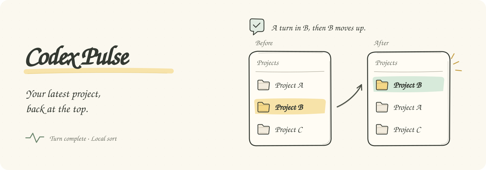
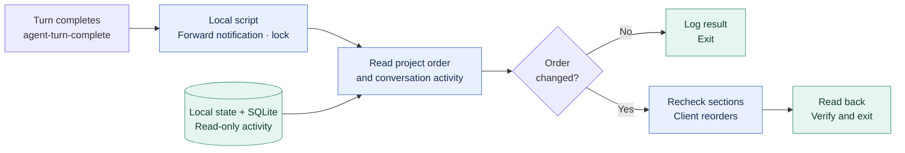

# Codex Pulse

[简体中文](README.md) · **English**

<p align="center">
  
</p>

**Keep Codex sidebar projects ordered by recent conversations.**

After each conversation turn, Codex Pulse runs a local script to move recently active local projects up, then exits.

- **Event driven**: no polling or persistent background service.
- **Local computation**: timestamp sorting makes no additional model calls or use of your model allowance.
- **Updates when needed**: an already correct order produces no reorder request.

## See the result

Starting with **A → B → C**, assuming no other project becomes active:

| What you do | Project order | Reorder requests |
| --- | --- | --- |
| Continue chatting in A | A → B → C | 0 |
| Finish a turn in B | **B → A → C** | **1** |
| Continue chatting in B | B → A → C | 0 |

Windows verification on 2026-10-24 confirmed that a natural callback reordered projects and a repeated check made no further reorder request. See the [verification record](docs/verification.md).

## Get started

Send this prompt to your Agent in **Codex desktop**:

```text
Install and enable Codex Pulse:
https://github.com/flyl1u/fly-CodexPulse
Follow the repo's setup instructions.
Preserve existing notifications and
verify the turn-completion callback.
```

[Manual installation, checks, and uninstall →](docs/installation.en.md)

## How it works

**Turn completes → read local activity → compare order → reorder if needed and verify.**

Each project uses its latest eligible conversation activity; ties retain the current order. The original notification is forwarded first, and a lock serializes overlapping callbacks.

<details>
<summary>View the architecture</summary>

<!-- architecture:start -->


[SVG](docs/diagrams/architecture.en.svg) · [PNG](docs/diagrams/architecture.en.png) · [Mermaid source](docs/diagrams/architecture.en.mmd)
<!-- architecture:end -->

</details>

## Scope

- **Projects**: local Codex projects in the default Projects section. Pinned projects, custom sections, remote projects, and ChatGPT project positions are preserved.
- **Environment**: verified on Windows with Codex desktop; other platforms remain unverified. The local App Tools pipe is required. See [requirements](docs/installation.en.md#requirements).
- **Local data**: SQLite connections are read-only, and diagnostic logs contain no conversation text. An unchanged order still involves reads and logging.

Reordering uses the client's own interface. It does not patch Codex or directly overwrite the running client's global state file. The App Tools pipe and local data structures are internal interfaces and may need adaptation after client updates. This is an independent tool.

## Read more

[Install and uninstall](docs/installation.en.md) · [Verification](docs/verification.md) · [Implementation plan](docs/plan.md) · [Historical read-only planner](docs/planner.md) · [Diagram sources](docs/diagrams/README.md)

## License

[MIT](LICENSE) · Copyright © 2026 fly liu.
