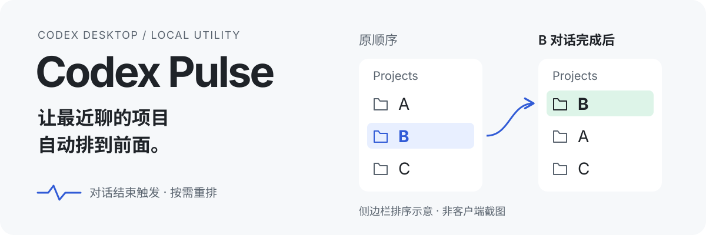
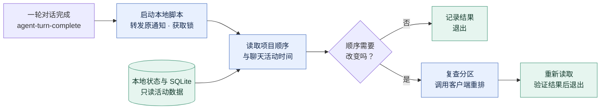

# CodexPulse

**简体中文** · [English](README.en.md)

<p align="center">
  
</p>

**让 Codex 侧边栏按最近对话排列项目。**
每轮对话结束后，CodexPulse 启动本地脚本，把最近活跃的本机项目往前排，处理完就退出，不消耗额度，排序可能有一定延迟，约15s


## 看一次就懂

假设最初是 **A → B → C**，期间没有其他项目变得活跃：

| 你的操作 | 项目顺序 | 重排请求 |
| --- | --- | --- |
| 继续在 A 里聊天 | A → B → C | 0 次 |
| 在 B 完成一轮对话 | **B → A → C** | **1 次** |
| 接着在 B 里聊天 | B → A → C | 0 次 |

2026-10-24 的 Windows 实测已确认：自然触发的回调完成了重排，随后重复检查没有再次重排。见[验证记录](docs/verification.md)。

## 设计架构

**对话结束 → 读取本地活动时间 → 比较顺序 → 按需重排并回读确认。**

同一项目取最近一次有效聊天活动；时间相同时保留原顺序。已有通知会先原样转发，并发回调通过锁排队执行。

<!-- architecture:start -->


[SVG](docs/diagrams/architecture.zh-CN.svg) · [PNG](docs/diagrams/architecture.zh-CN.png) · [Mermaid 源码](docs/diagrams/architecture.zh-CN.mmd)
<!-- architecture:end -->

## 开始使用

在 **Codex 桌面端**，把下面这段发给 Agent：

```text
请帮我下载、安装并启用 CodexPulse：
https://github.com/flyl1u/CodexPulse/releases/latest/download/codex-pulse.zip
将发布包解压到准备长期保留的目录，
按包内说明检查环境、保留原有通知，
并验证安装和对话结束回调是否生效。
```

[手动安装、检查与卸载 →](docs/installation.md)

## 作用范围

- **排序对象**：默认 Projects 区域中的本机 Codex 项目。置顶项目、自定义分区、远程项目和 ChatGPT 项目的位置保持不变。
- **运行环境**：目前在 Windows + Codex 桌面端验证，其他平台待验证。需要本地 App Tools 管道；详细依赖见[安装说明](docs/installation.md#环境要求)。
- **本地数据**：SQLite 使用只读连接；诊断日志不保存聊天正文。顺序未变时仍会读取数据、记录日志。

重排通过客户端接口完成，不修改 Codex 安装包，也不直接覆盖运行中的全局状态文件。App Tools 管道和本地数据结构属于内部接口，客户端更新后可能需要适配。本项目是独立工具。

## 进一步了解

[安装与卸载](docs/installation.md) · [验证记录](docs/verification.md) · [实现方案](docs/plan.md) · [历史只读规划器](docs/planner.md) · [架构图源码](docs/diagrams/README.md)

## 许可证

[MIT](LICENSE) · Copyright © 2026 fly liu.
