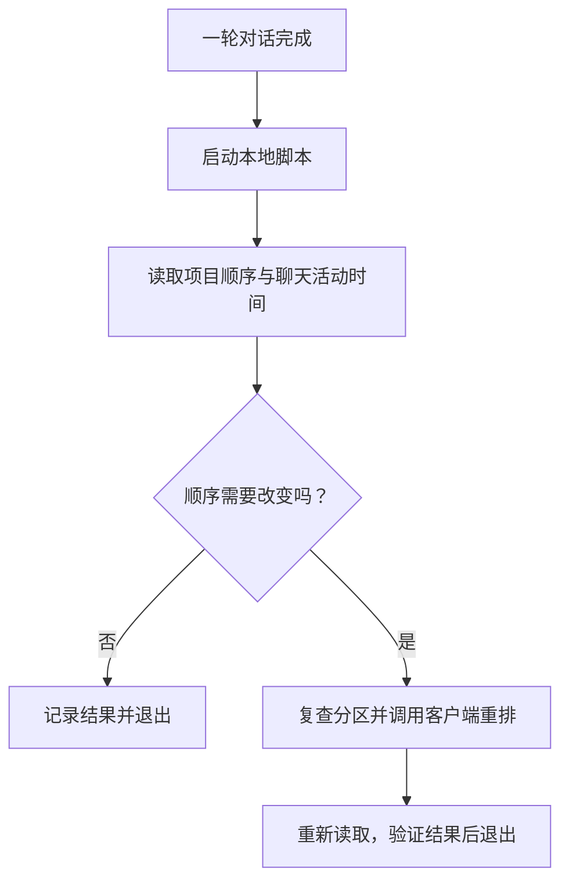

# Codex Pulse · 项目脉动

[English](README.md) · **简体中文**

**聊完之后，让最近活跃的 Codex 项目更容易找到。**

Codex Pulse 是运行在你电脑上的小程序。每轮对话结束后，它检查 Codex 侧边栏的项目顺序，需要时把最近活跃的本机项目往前排。

排序由脚本按时间计算：不需要让 AI 判断，处理完就退出。

- 对话结束时触发，不轮询，也没有一直监听消息的后台程序。
- 排序本身不额外调用模型。
- 计算结果与现有排列不同，才更新侧边栏。
- 保留置顶项目、自定义分区和原有通知。

## 一个直观的例子

假设开始是 **A → B → C**，期间没有其他项目变得活跃：

| 你做了什么 | 项目顺序 | 更新排序次数 |
| --- | --- | --- |
| 继续在 A 里聊天 | A → B → C | 0 |
| 转到 B，完成一轮对话 | B → A → C | 1 |
| 接着在 B 里聊天 | B → A → C | 0 |

顺序不变时，仍会启动脚本、读取数据并记录简短日志。**“零次更新排序”不等于“电脑完全不做任何工作”。**

## 到底是谁在运行，什么时候运行？

1. **你正常发消息，AI 正常回答。**
2. **这一轮回答结束后，Codex 软件自动启动本地脚本。**
3. **脚本读取项目归属、聊天活动时间和当前排列。**
4. **脚本计算应该怎么排。** 如果已经排对，就不更新侧边栏，直接结束。
5. **确实需要变化时，脚本请求客户端重排，再重新读取结果确认，随后退出。**

`agent-turn-complete` 的意思就是“助手这一轮回答结束了”。它是 Codex 给这个事件起的英文名称，你不用输入它。Codex 通过用户级 `notify` 设置启动回调，详见[官方通知文档](https://learn.chatgpt.com/docs/config-file/config-advanced#notifications)。

| 谁 | 负责什么 |
| --- | --- |
| AI 模型 | 回答你正常提出的问题。 |
| Codex 软件 | 在回答结束后启动脚本，并执行侧边栏的更新请求。 |
| Codex Pulse 脚本 | 比较时间，判断排序是否需要改变。 |

**你正常聊天仍然按正常规则消耗额度；排序本身不会额外向模型发起请求。** 排序只用到一点本地计算和磁盘读写，不需要模型帮忙决定哪个时间更新。

脚本不会一直开着等消息。做完这一次就退出，下次对话结束再由 Codex 启动一次。因此，项目顺序是在一轮回答完成后更新，不是在回答生成途中更新。

## 设计架构



进入排序检查前，回调先转发原有通知，再获取进程锁。多个聊天同时完成时，锁让这些回调排队执行。

| 模块 | 作用 |
| --- | --- |
| [`bin/codex-pulse.mjs`](bin/codex-pulse.mjs) | 接收回调、读取运行配置、处理错误并静默退出。 |
| [`src/events.mjs`](src/events.mjs) | 识别对话完成事件，原样转发已有通知。 |
| [`src/activity.mjs`](src/activity.mjs) | 用只读 SQLite 连接读取本机聊天活动。 |
| [`src/planner.mjs`](src/planner.mjs) | 识别聊天归属，计算稳定的项目顺序。 |
| [`src/app-client.mjs`](src/app-client.mjs) | 通过本地管道调用三个允许的 App Tools：获取项目、读取侧边栏、重排项目。 |
| [`src/runner.mjs`](src/runner.mjs) | 负责并发排队、写入前检查、执行重排、回读验证和日志。 |
| [`scripts/configure.py`](scripts/configure.py) | 通过 Codex 配置 API 安装或卸载回调。 |

## 为什么这样设计

### 有事情发生时，才做一次检查

一轮聊天结束，是检查项目活跃程度的合适时机。采用这个事件，离开电脑后不用定期空跑，也不用另开一个常驻服务。

### 用普通程序就能完成的规则

每个项目取所属有效聊天的最新活动时间，再从新到旧排序。优先使用聊天活跃时间，减少普通元数据变化对排序的干扰。归档聊天、没有项目的聊天和子智能体活动不计入。时间相同就保留原有次序；没有活动记录的项目排在有记录的项目之后。

同一项目里的不同聊天，都使用这一条规则。比较时间不需要提示词、模型推理或额外的排序 API Key。

### 先算清楚，再决定是否更新

脚本先计算目标顺序，再比较现在的顺序。活动记录和排列没有变化时，重复运行也不会不断重排。这叫“幂等”，在这里可以理解为：**同样的检查再做一次，不会把已经排好的项目来回折腾。**

### 由客户端更新自己的侧边栏

脚本只读本地状态和 SQLite 数据，不修改 Codex 安装包，也不覆盖运行中的客户端全局状态文件。需要重排时，通过客户端已有的 App Tools 通道提出请求，让客户端自己完成更新。

### 更新前后都检查

脚本让自身的多个回调排队运行；写入前重读分区，写入后再次读取并验证。如果检查期间布局发生变化，就在限定次数内重新计算。接口没有原子条件写入能力，所以这些措施能缩小竞争窗口，不代表所有客户端之间拥有同一个事务。

### 安装之后，也能恢复

安装时保存原通知命令和本地配置备份。每次回调先转发原通知，再检查排序。重复安装不会一层套一层；卸载会恢复原通知。如果你之后自行改过通知配置，卸载器会拒绝覆盖你的修改。

## 开始使用

### 环境要求

- 能提供本地 App Tools 管道的 Codex 桌面客户端；当前实测平台是 **Windows**。
- **Node.js 24 或更新版本**，使用内置 SQLite。
- **Python 3.11 或更新版本**，安装器使用标准库中的 `tomllib`。
- Git，用于克隆仓库。

不用安装 npm 或 pip 依赖。安装器可以使用 Codex 自带的运行环境。

### 安装

克隆仓库，并在 Codex 桌面端中把这个目录作为项目打开：

```powershell
git clone https://github.com/flyl1u/fly-CodexPulse.git
cd fly-CodexPulse
```

通过 Codex 提供、继承了桌面客户端环境的 shell，在项目根目录执行：

```powershell
python scripts/configure.py install
python scripts/configure.py status
```

安装器通过 `CODEX_CLI_PATH`、`CODEX_MCP_NODE_PATH` 或 PATH 寻找可执行文件，也可以使用 `--codex` 和 `--node` 手动指定。只指定可执行文件路径，不会凭空创建运行时需要的桌面通信管道和聊天身份。

安装器通过 Codex 配置 API 修改用户级 `notify`，并检查其他配置值保持不变。客户端加载新配置后，回调开始运行。

**安装后请保留当前目录位置。** 回调使用绝对路径，移动或删除项目之前应先卸载。

### 怎么确认真的运行了

正常完成一轮对话，然后检查 `runtime/events.jsonl`：`trigger: "notify"` 表示对话完成回调；`check` 和 `apply` 表示手动运行。

其中与结果有关的字段如下：

```jsonl
{"trigger":"notify","status":"sorted","count":3,"writes":1}
{"trigger":"notify","status":"unchanged","count":3,"writes":0}
```

`writes` 统计的是更新侧边栏的请求次数，日志和锁文件的读写另算。安装器的 `status` 用于确认配置；事件日志用于确认回调实际执行过。

### 手动检查或重排

以下命令需要 Codex 桌面端提供的 `CODEX_APP_TOOLS_PIPE_PATH` 和当前聊天身份：

```powershell
& $env:CODEX_MCP_NODE_PATH --disable-warning=ExperimentalWarning bin/codex-pulse.mjs check
& $env:CODEX_MCP_NODE_PATH --disable-warning=ExperimentalWarning bin/codex-pulse.mjs apply
```

`check` 只计算、不更新侧边栏；`apply` 按需更新并验证结果。正常回调静默运行；发生错误时记录本地日志，不中断你的对话。

### 卸载

```powershell
python scripts/configure.py uninstall
```

卸载恢复之前的通知命令。配置备份保留在被 Git 忽略的 `runtime/` 目录。

## 作用范围与兼容性

| 自动排序 | 保留原安排 |
| --- | --- |
| 默认 Projects 区域中的本机 Codex 项目 | 置顶项目和自定义分区 |
| 有效的本机聊天活动 | 远程项目和 ChatGPT 项目的位置 |

对话完成事件和配置 API 是 Codex 提供的接入方式。**App Tools 管道和本地状态、数据库结构属于客户端内部接口**，客户端更新后可能需要适配。本项目是独立工具，并非 OpenAI 官方产品。

当前安装方式使用 `notify`。代码同时具备解析 `Stop` 事件的能力，供后续或手动接入使用；安装器没有另外注册 Stop Hook。

## 验证与本地数据

当前实现通过了 **15 项 Node.js 测试**和安装器集成测试。2026-10-24 的 Windows 实测确认：自然触发的回调实际完成了自动重排，随后重复检查时更新次数为零。观测结果和耗时见[验证记录](docs/verification.md)。

```powershell
& $env:CODEX_MCP_NODE_PATH --disable-warning=ExperimentalWarning --test
python -m unittest discover -s tests -p 'test_*.py' -v
```

安装器集成测试需要 Codex 运行环境，使用临时的独立数据目录，不修改真实用户配置。

`work/`、`runtime/`、数据库、日志、凭据和本地快照均被 Git 忽略。诊断日志只记录时间、状态、数量、耗时和错误码，不保存聊天正文。仓库不包含个人项目清单或聊天记录。

## 更多说明

- [English README](README.md)
- [实现方案](docs/plan.md)
- [历史 Python 只读规划器](docs/planner.md)
- [验证记录](docs/verification.md)
- [仓库 description 与 topics](.github/repository.json)

## 许可证

[MIT](LICENSE) · Copyright © 2026 fly liu.
